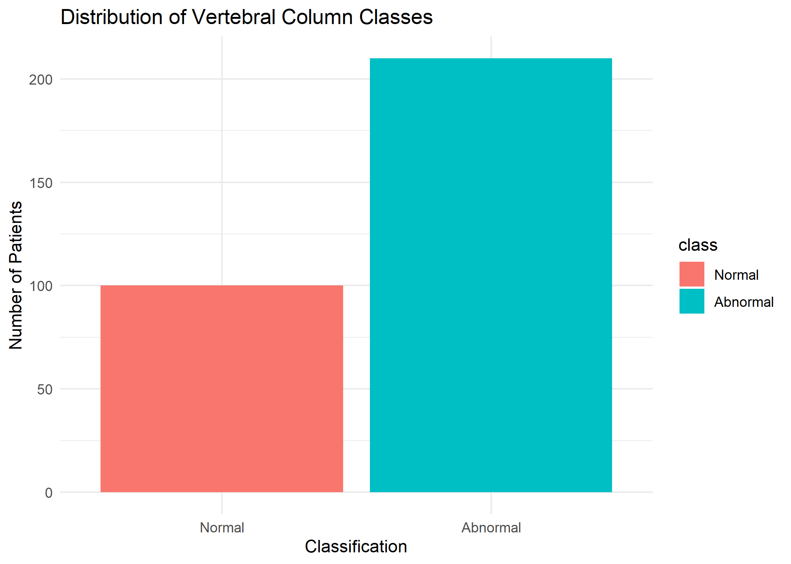

# Classification of Vertebral Column Abnormalities Using Machine Learning

**Module:** IT4133 – Bioinformatics and Computational Biology  
**Student Registration Number:** 2021ICT14  
**Programming Language:** R  
**Dataset:** UCI Vertebral Column Dataset

---

## 1. Abstract

Vertebral column disorders can affect spinal structure and function, making the analysis of biomechanical measurements important in orthopaedic research. This project investigates the classification of vertebral column abnormalities using publicly available biomedical data and machine learning techniques. The UCI Vertebral Column dataset, containing 310 patient observations and six biomechanical measurements, was selected for the analysis. Data quality assessment, preprocessing, exploratory data analysis, correlation analysis and statistical testing were performed using R. Logistic regression and decision tree classification models were developed to distinguish between normal and abnormal vertebral columns. Their performance was evaluated using confusion matrices, accuracy, precision, recall, specificity and F1-score. The project also investigates the relative importance of biomechanical features in the decision tree model. The findings provide an experimental comparison of two classification approaches for this biomedical dataset.

## 2. Introduction

### 2.1 Background

The vertebral column, commonly known as the spine, is an important component of the human skeletal system. It provides structural support, protects the spinal cord and contributes to body movement.

Abnormalities in the vertebral column can be associated with different orthopaedic conditions, including disc hernia and spondylolisthesis. Identifying patterns in biomechanical measurements can help researchers investigate the relationship between spinal characteristics and abnormal conditions.

Biomedical datasets provide opportunities to apply statistical analysis and machine learning to investigate health-related problems. Classification techniques can be used to identify patterns in patient measurements and distinguish between different clinical categories.

### 2.2 Problem Statement

The identification of vertebral column abnormalities involves analysing multiple biomechanical measurements. Understanding how these measurements differ between normal and abnormal cases is useful for biomedical data analysis.

This project addresses the following research question:

**Can biomechanical measurements of the vertebral column be used to classify patients into normal and abnormal categories using logistic regression and decision tree algorithms?**

### 2.3 Aim

The main aim is to investigate the use of statistical analysis and machine learning techniques to classify vertebral column abnormalities using publicly available biomedical data.

### 2.4 Objectives

- Obtain and import a publicly available vertebral column dataset.
- Assess data quality and perform appropriate preprocessing.
- Explore the distribution of biomechanical measurements.
- Investigate relationships between numerical features using correlation analysis.
- Examine differences between normal and abnormal groups using statistical testing.
- Develop logistic regression and decision tree classification models.
- Evaluate and compare the predictive performance of both models.
- Identify important biomechanical measurements contributing to classification.

## 3. Dataset Description

### 3.1 Dataset Source

The project uses the Vertebral Column dataset from the UCI Machine Learning Repository.

Dataset link: https://archive.ics.uci.edu/dataset/212/vertebral+column

The dataset was developed using biomedical measurements collected in an orthopaedic research setting. It contains information about the shape and orientation of the pelvis and lumbar spine.

The binary classification version was selected. In this version, the original categories of disc hernia and spondylolisthesis are combined into one abnormal category.

### 3.2 Dataset Characteristics

The dataset contains 310 patient observations and six numerical biomechanical features.

| Characteristic | Description |
|---|---|
| Total observations | 310 |
| Numerical features | 6 |
| Target variable | Class |
| Classification type | Binary |
| Normal observations | 100 |
| Abnormal observations | 210 |
| Missing values | None reported by UCI |

### 3.3 Dataset Variables

| Variable | Description |
|---|---|
| pelvic_incidence | Pelvic incidence measurement |
| pelvic_tilt | Pelvic tilt measurement |
| lumbar_lordosis_angle | Lumbar lordosis angle |
| sacral_slope | Sacral slope measurement |
| pelvic_radius | Pelvic radius measurement |
| degree_spondylolisthesis | Degree of spondylolisthesis |
| class | Normal or Abnormal classification |

The six numerical attributes are used as predictor variables, while the class variable is used as the target for classification.

### 3.4 Ethical and Licensing Considerations

The project uses an existing publicly available dataset. No new patient data were collected, and no individuals were contacted.

The dataset is distributed under the Creative Commons Attribution 4.0 International licence (CC BY 4.0). Appropriate attribution is provided in the references.

## 4. Methodology

The project was implemented in R using a structured analytical workflow.

### 4.1 Tools and Packages

The following R packages were used:

- **ggplot2:** Data visualisation and graphical analysis.
- **rpart:** Decision tree model development.
- **rpart.plot:** Decision tree visualisation.

Additional functionality was provided through built-in R functions for statistical testing, data preprocessing, logistic regression, correlation analysis and model evaluation.

### 4.2 Data Import

The dataset was downloaded from the UCI Machine Learning Repository using the `download.file()` function.

The `read.table()` function was used to import the dataset into R. Appropriate column names were assigned to the six numerical measurements and the classification variable.

The original class labels were converted into readable factor levels:

- NO → Normal
- AB → Abnormal

### 4.3 Data Quality Assessment

Initial data quality assessment was conducted to understand the structure and condition of the dataset.

The following checks were performed:

- Dataset dimensions.
- Missing-value counts.
- Duplicate observation counts.
- Variable summaries.
- Class frequency and percentage distributions.

These checks provided an overview of the dataset before analysis.

### 4.4 Data Preprocessing

A cleaned copy of the original dataset was created.

The preprocessing procedure included:

1. Removing observations containing missing values.
2. Removing duplicate observations.
3. Removing unused factor levels.
4. Verifying the cleaned dataset dimensions and class distribution.

The cleaned dataset was exported as a CSV file for reproducibility.

### 4.5 Exploratory Data Analysis

Exploratory data analysis was conducted to investigate the characteristics and distributions of the biomechanical measurements.

The following visualisations were generated:

- Class distribution bar chart.
- Histograms of all six numerical features.
- Boxplots comparing numerical features between normal and abnormal groups.
- Correlation heatmap.

These visualisations help identify differences in feature distributions, potential outliers and relationships between numerical measurements.

### 4.6 Correlation Analysis

Pearson correlation analysis was performed on the six numerical features using the `cor()` function.

A correlation matrix was generated and visualised using a heatmap.

This analysis was used to investigate the strength and direction of linear relationships between biomechanical measurements.

### 4.7 Statistical Analysis

The Wilcoxon rank-sum test was applied separately to each numerical feature to investigate whether its distribution differed between the normal and abnormal groups.

The Bonferroni correction was applied to adjust the p-values because multiple statistical tests were conducted.

A significance threshold of 0.05 was used when interpreting adjusted p-values.

### 4.8 Training and Testing Data

The cleaned dataset was divided into training and testing subsets using a stratified sampling approach.

The observations were separated according to their classification:

- Normal observations.
- Abnormal observations.

Approximately 70% of observations from each class were assigned to the training dataset, while the remaining 30% were assigned to the testing dataset.

A random seed of 123 was used to support reproducibility.

### 4.9 Logistic Regression

Logistic regression was implemented using R's `glm()` function with a binomial family and logit link.

The model was trained using the six biomechanical measurements as predictor variables and the class variable as the target.

Predicted probabilities were generated for the test observations. A threshold of 0.5 was used to convert predicted probabilities into normal or abnormal classifications.

### 4.10 Decision Tree

A decision tree classifier was developed using the `rpart` package.

The model used the same training dataset and predictor variables as logistic regression.

The classification method was specified as `class`, with a complexity parameter of 0.01 and a minimum split size of 10.

The resulting decision tree was visualised and its variable importance values were extracted when available.

### 4.11 Model Evaluation

Both classification models were evaluated using the independent test subset.

The following evaluation metrics were calculated:

- **Accuracy:** Proportion of correctly classified observations.
- **Precision:** Proportion of predicted abnormal observations that were actually abnormal.
- **Recall:** Proportion of actual abnormal observations correctly identified.
- **Specificity:** Proportion of actual normal observations correctly identified.
- **F1-score:** Harmonic mean of precision and recall.

Confusion matrices were also generated to examine correct and incorrect classifications.

## 5. Results


### 5.1 Dataset Quality

The original dataset contained 310 observations and seven columns, including six numerical predictor variables and one classification variable.

The missing-value and duplicate-record checks were performed before preprocessing.

**Actual cleaned dataset observations:** [INSERT VALUE]

**Missing observations identified:** [INSERT VALUE]

**Duplicate observations identified:** [INSERT VALUE]

### 5.2 Class Distribution

The class distribution visualisation illustrates the number of normal and abnormal observations.



The original dataset contains 100 normal observations and 210 abnormal observations, indicating an unequal distribution between the two classes.

### 5.3 Feature Distribution

Histograms and boxplots were generated for all six biomechanical measurements.

These visualisations were used to investigate differences in the numerical measurements between normal and abnormal groups.


The remaining feature distribution and boxplot figures are available in `results/figures/`.

### 5.4 Correlation Analysis


The correlation matrix provides an overview of relationships between the six biomechanical measurements.

The strongest positive and negative relationships should be identified and discussed using the generated correlation matrix.

### 5.5 Statistical Testing

The Wilcoxon rank-sum tests were performed for all six features.

The adjusted p-values were used to determine which features showed statistically significant distributional differences between the two classification groups.

Refer to `results/tables/statistical_tests.csv` for the complete statistical results.

**Significant features:** [INSERT FEATURES BASED ON ADJUSTED P-VALUES]

###### ### 5.6 Classification Model Performance

The performance of the revised logistic regression model and decision tree model was evaluated using the testing dataset.

| Evaluation metric | Logistic Regression (Revised) | Decision Tree |
|---|---:|---:|
| Accuracy | 78.49% | 74.19% |
| Precision | 83.08% | 85.45% |
| Recall (Sensitivity) | 85.71% | 74.60% |
| Specificity | 63.33% | 73.33% |
| F1-score | 84.38% | 79.66% |

The revised logistic regression model achieved an accuracy of 78.49%, outperforming the decision tree model, which achieved 74.19%.

The revised logistic regression model also achieved higher recall (85.71%) and F1-score (84.38%). This indicates that it identified a greater proportion of abnormal observations and achieved a better balance between precision and recall.

However, the decision tree achieved higher precision (85.45%) and specificity (73.33%) compared with the revised logistic regression model. This indicates better performance in correctly identifying normal observations and a higher proportion of correct predictions among cases classified as abnormal.

Overall, the revised logistic regression model demonstrated better performance in accuracy, recall and F1-score, while the decision tree performed better in precision and specificity. Based on these results, the revised logistic regression model provided the stronger overall performance on the selected test dataset.


### 5.7 Feature Importance


The decision tree variable importance analysis was used to identify which biomechanical measurements contributed most to the model's classification decisions.

**Most important feature:** [INSERT FROM ACTUAL OUTPUT]

## ## 6. Discussion

The analysis investigated the use of biomechanical measurements to classify vertebral column abnormalities using statistical methods and machine learning algorithms.

Exploratory data analysis was used to examine the distributions of the six biomechanical measurements. The visualisations provided an overview of differences between normal and abnormal observations. Correlation analysis was also performed to investigate relationships between the numerical features.

The Wilcoxon rank-sum tests provided a statistical approach for examining differences in feature distributions between the two classification groups. The Bonferroni correction was applied to account for multiple comparisons.

The classification results showed that the revised logistic regression model achieved an accuracy of 78.49%, compared with 74.19% for the decision tree. Logistic regression also achieved a higher recall of 85.71% and F1-score of 84.38%.

These results suggest that the revised logistic regression model was more effective at identifying abnormal observations in the selected test dataset. However, the decision tree achieved higher precision and specificity, indicating that it performed better in correctly identifying normal observations and in the precision of its abnormal predictions.

The results demonstrate that different classification algorithms can produce different strengths depending on the evaluation metric. Logistic regression provided stronger overall performance based on accuracy, recall and F1-score, whereas the decision tree provided better precision and specificity.

The feature importance analysis of the decision tree can provide additional insight into the measurements used for classification. However, feature importance indicates the contribution of variables to the model and does not establish a causal relationship with vertebral column abnormalities.

Overall, the findings indicate that biomechanical measurements contain useful information for distinguishing between normal and abnormal vertebral column observations. Nevertheless, the results should be interpreted within the limitations of the dataset and experimental design.

## 7. Limitations

Several limitations should be considered when interpreting the results.

1. **Dataset size:** The dataset contains only 310 observations, which limits the amount of information available for model training and evaluation.

2. **Class imbalance:** The dataset contains more abnormal observations than normal observations. Therefore, accuracy alone may not provide a complete assessment of classification performance.

3. **Limited features:** The analysis uses six biomechanical measurements and does not include other potentially relevant clinical information.

4. **Model selection:** Only logistic regression and decision tree algorithms were evaluated. Other classification techniques may produce different results.

5. **Single train-test split:** The evaluation is based on one stratified 70:30 split. Different random partitions may produce different performance results.

6. **External validation:** The models were not tested on an independent external clinical dataset.

7. **Clinical application:** The models are intended for educational and research purposes and should not be considered clinically validated diagnostic tools.

## 8. Conclusion and Future Work

This project investigated the classification of vertebral column abnormalities using a publicly available biomedical dataset.

A complete analytical workflow was implemented in R, including data import, quality assessment, preprocessing, exploratory data analysis, correlation analysis, statistical testing and predictive modelling.

Logistic regression and decision tree algorithms were developed and evaluated using a separate test dataset. Their performance was assessed using confusion matrices and multiple classification metrics.

The experimental results should be interpreted in the context of the dataset size, class distribution and selected modelling methods.

Future work could investigate additional classification algorithms, repeated stratified cross-validation, hyperparameter tuning and external validation using independent biomedical datasets.

## 9. Reproducibility

### Requirements

- R programming language.
- RStudio (recommended).
- Internet connection for the initial dataset download.

### Required Packages

```r
install.packages(c(
  "ggplot2",
  "rpart",
  "rpart.plot"
))
```

### Running the Project

1. Clone or download this GitHub repository.
2. Open the repository root directory in RStudio.
3. Open `code/analysis.R`.
4. Run the complete script from beginning to end.
5. The dataset will be downloaded automatically if it is not already present.
6. Figures, tables, model files and summaries will be generated in the `results/` directory.

A random seed is used for the training and testing split. The R session information is also saved to support reproducibility.

## 10. References

1. Barreto, G., & Neto, A. (2005). *Vertebral Column* [Dataset]. UCI Machine Learning Repository. https://doi.org/10.24432/C5K89B

2. R Core Team. *R: A Language and Environment for Statistical Computing*. R Foundation for Statistical Computing. https://www.r-project.org/

3. Wickham, H. (2016). *ggplot2: Elegant Graphics for Data Analysis*. Springer. https://ggplot2.tidyverse.org/

4. Therneau, T. M., & Atkinson, B. (2019). *rpart: Recursive Partitioning and Regression Trees*. R package documentation. https://cran.r-project.org/package=rpart

5. Milborrow, S. *rpart.plot: Plot 'rpart' Models*. R package documentation. https://cran.r-project.org/package=rpart.plot

---

**Project:** IT4133 Bioinformatics and Computational Biology  
**Registration Number:** 2021ICT14  
**Language:** R
